# 🇮🇹 Vera Italia

<p align="center">
  <strong>SORTEZ DES CIRCUITS CLASSIQUES.</strong><br>
  Découvrez les endroits les plus authentiques et les plus surprenants de l’Italie méconnue.
</p>

<p align="center">
  <a href="https://coco921609.github.io/vera_italia/"><strong>Découvrir l’application Web</strong></a>
  &nbsp;·&nbsp;
  <a href="https://github.com/Coco921609/vera_italia"><strong>Code source</strong></a>
</p>

<p align="center">
  
  
  
</p>

---

## ✦ L’esprit Vera Italia

**Vera Italia** est une application Flutter consacrée aux lieux moins connus d’Italie. Son écran d’ouverture propose de choisir entre le français, l’anglais et l’italien, avant d’accéder à un espace d’exploration organisé par destinations et régions.

L’application met en avant des sites naturels, des villages, des paysages, des grottes et des lieux singuliers, avec des pages illustrées pour approfondir chaque découverte.

## ✦ Une Italie à explorer autrement

| UNIVERS | DÉCOUVERTES |
|:--|:--|
| 🏔️ **Italie du Nord** | Lac de Resia et Dolomites |
| 🌿 **Italie centrale** | Bomarzo, Frasassi, Val d’Orcia, Civita di Bagnoregio, jardin de Ninfa, Rocca Calascio et Giardino dei Tarocchi |
| 🌊 **Italie du Sud** | San Fele, Furore, îles Tremiti, Alberobello, grottes de Castellana et Ischia |
| 🌋 **Sicile** | Marais salants de Margherita di Savoia, Grotte Mangiapane, Scala dei Turchi et Sicile volcanique |
| ✨ **Autres lieux présentés** | Lugano |

## ✦ Le parcours de l’application

<p align="center">
  <strong>22 CAPTURES · FORMAT MOBILE · 3 LANGUES</strong><br>
  <em>De l’écran d’accueil aux fiches des lieux à découvrir.</em>
</p>

<p align="center"><em>Captures réalisées depuis les écrans Flutter · 430 × 932 px</em></p>

<table>
<tr><td align="center"><strong>01 — Accueil</strong><br><a href="docs/screenshots/01-accueil.png"></a></td><td align="center"><strong>02 — Exploration</strong><br><a href="docs/screenshots/02-exploration.png">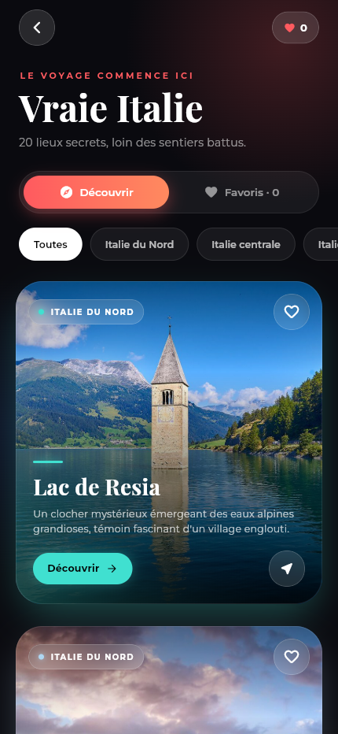</a></td><td align="center"><strong>03 — Lac de Resia</strong><br><a href="docs/screenshots/03-lac-de-resia.png">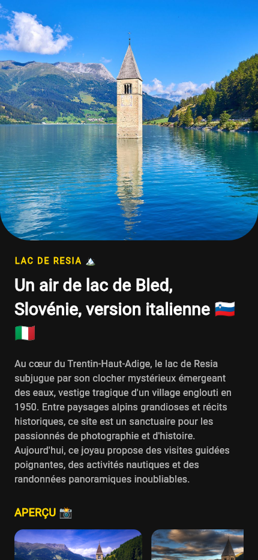</a></td></tr>
<tr><td align="center"><strong>04 — Dolomites</strong><br><a href="docs/screenshots/04-dolomites.png">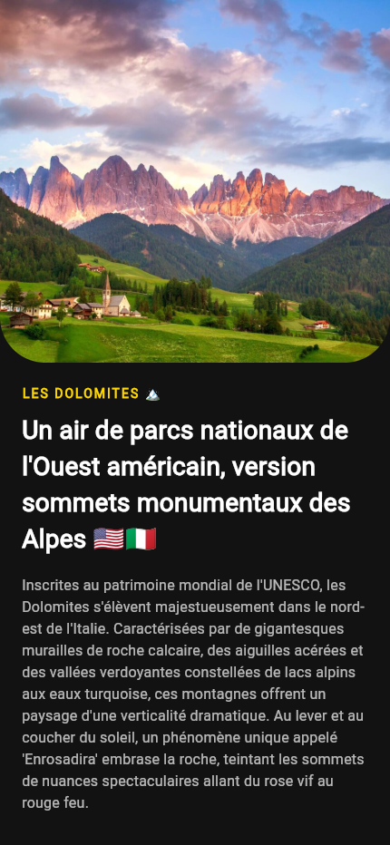</a></td><td align="center"><strong>05 — Parc de Bomarzo</strong><br><a href="docs/screenshots/05-parc-de-bomarzo.png">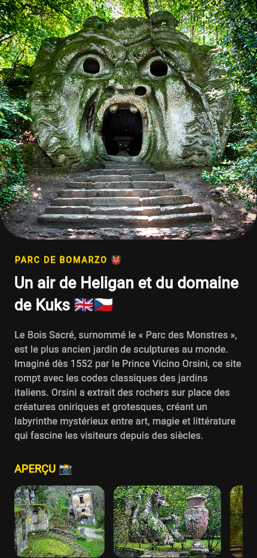</a></td><td align="center"><strong>06 — Grottes de Frasassi</strong><br><a href="docs/screenshots/06-grottes-de-frasassi.png">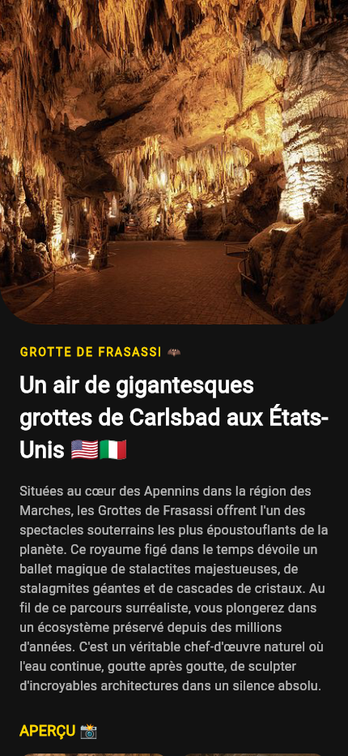</a></td></tr>
<tr><td align="center"><strong>07 — Val d’Orcia</strong><br><a href="docs/screenshots/07-val-dorcia.png">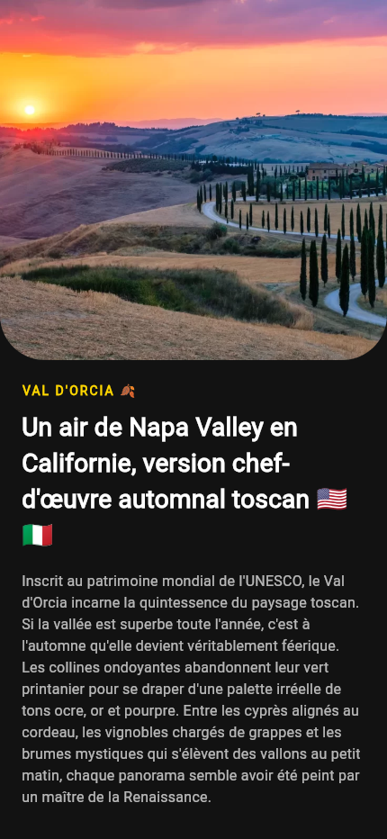</a></td><td align="center"><strong>08 — Civita di Bagnoregio</strong><br><a href="docs/screenshots/08-civita-di-bagnoregio.png">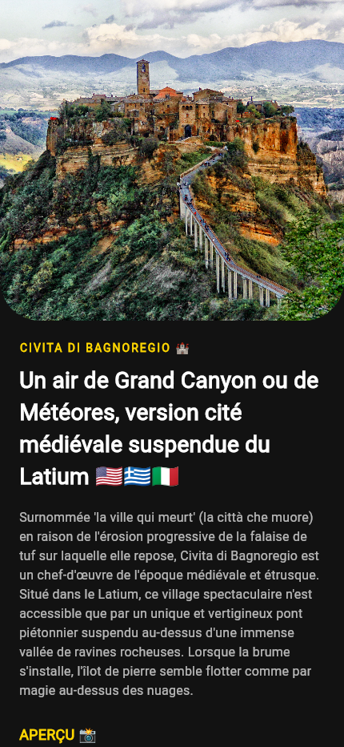</a></td><td align="center"><strong>09 — Jardin de Ninfa</strong><br><a href="docs/screenshots/09-jardin-de-ninfa.png">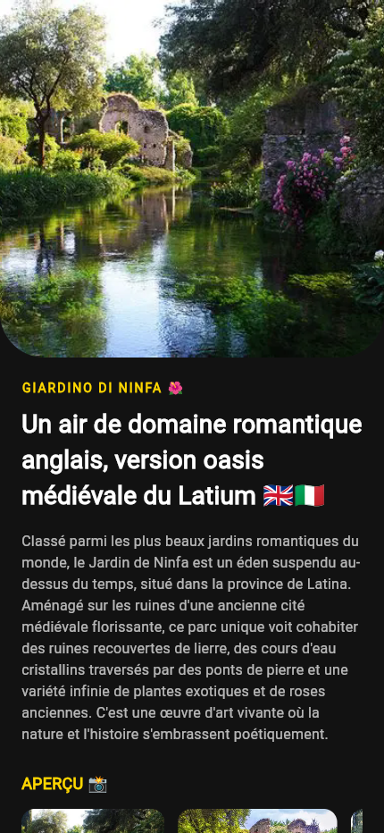</a></td></tr>
<tr><td align="center"><strong>10 — Rocca Calascio</strong><br><a href="docs/screenshots/10-rocca-calascio.png">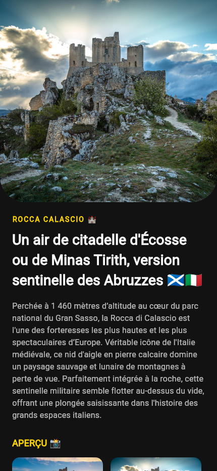</a></td><td align="center"><strong>11 — Giardino dei Tarocchi</strong><br><a href="docs/screenshots/11-giardino-dei-tarocchi.png">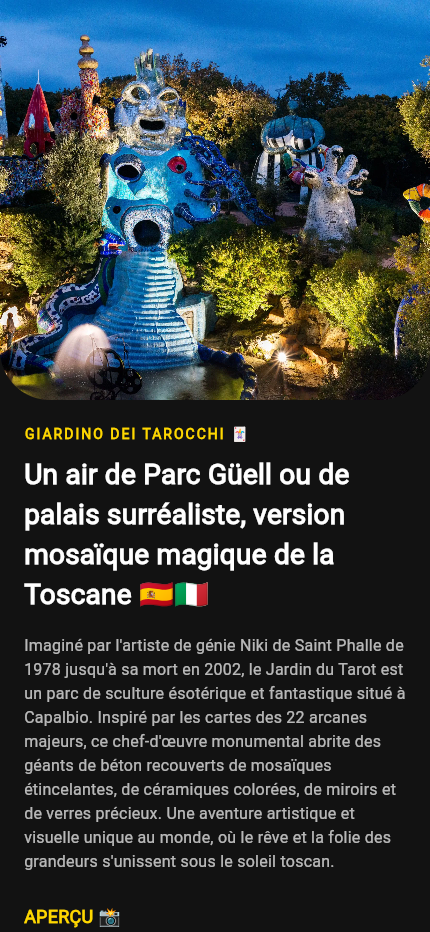</a></td><td align="center"><strong>12 — Chutes de San Fele</strong><br><a href="docs/screenshots/12-chutes-de-san-fele.png">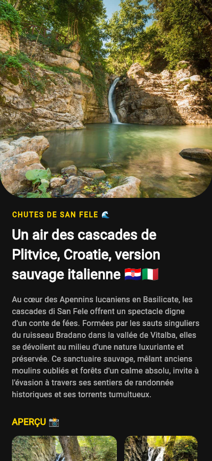</a></td></tr>
<tr><td align="center"><strong>13 — Lugano</strong><br><a href="docs/screenshots/13-lugano.png">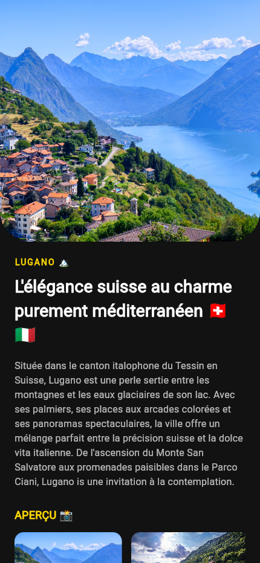</a></td><td align="center"><strong>14 — Furore</strong><br><a href="docs/screenshots/14-furore.png">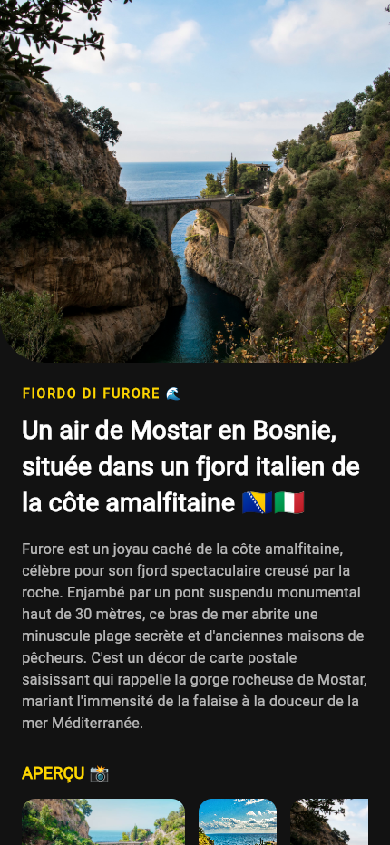</a></td><td align="center"><strong>15 — Îles Tremiti</strong><br><a href="docs/screenshots/15-iles-tremiti.png">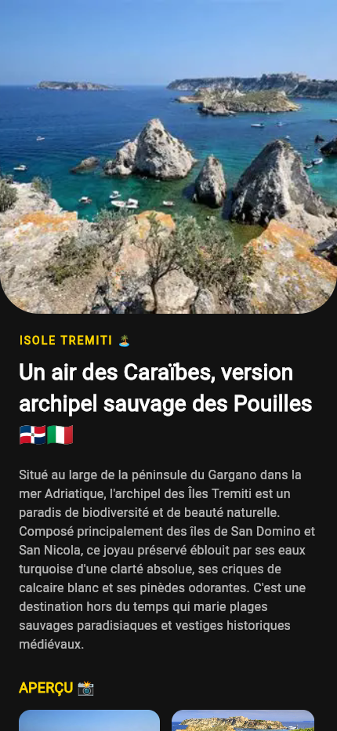</a></td></tr>
<tr><td align="center"><strong>16 — Alberobello</strong><br><a href="docs/screenshots/16-alberobello.png">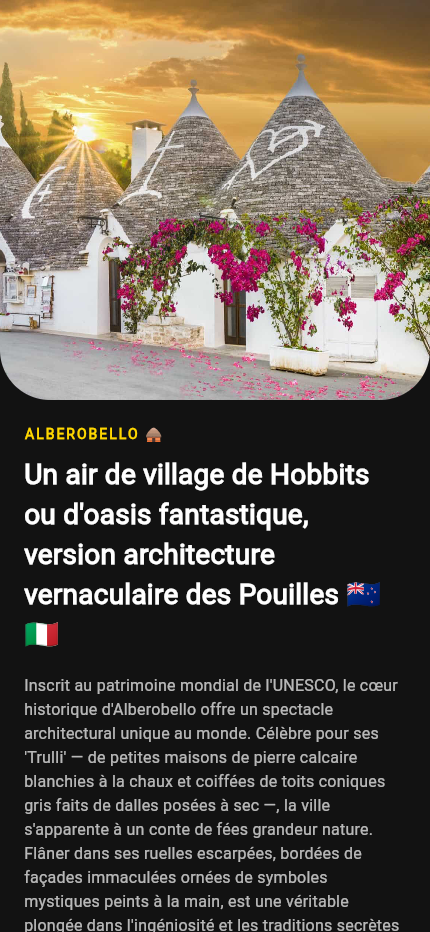</a></td><td align="center"><strong>17 — Grottes de Castellana</strong><br><a href="docs/screenshots/17-grottes-de-castellana.png">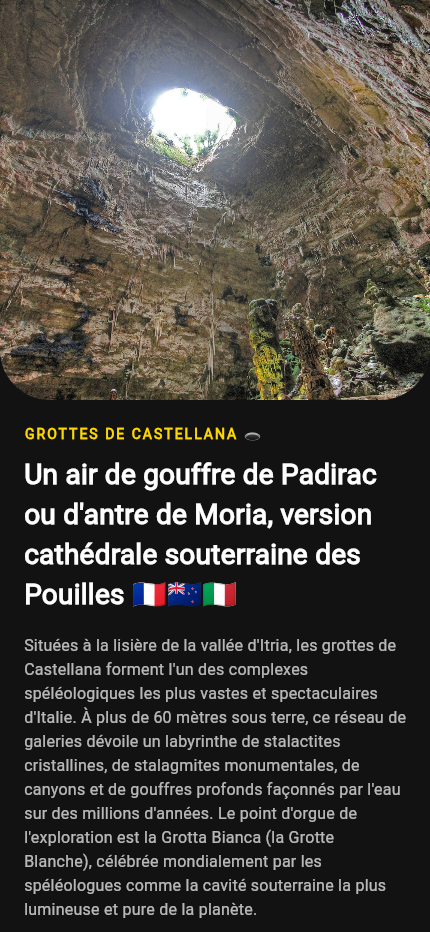</a></td><td align="center"><strong>18 — Ischia</strong><br><a href="docs/screenshots/18-ischia.png">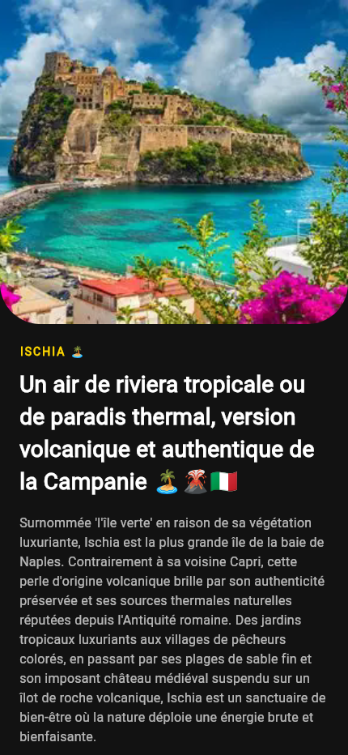</a></td></tr>
<tr><td align="center"><strong>19 — Margherita di Savoia</strong><br><a href="docs/screenshots/19-margherita-di-savoia.png">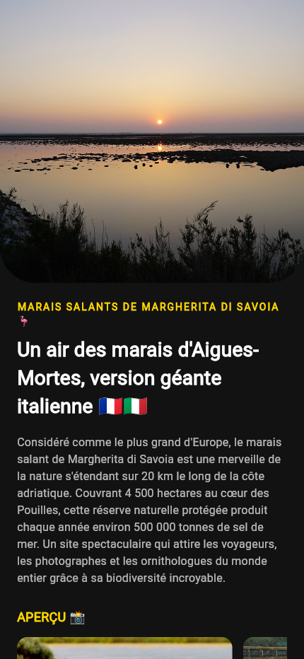</a></td><td align="center"><strong>20 — Grotte Mangiapane</strong><br><a href="docs/screenshots/20-grotte-mangiapane.png">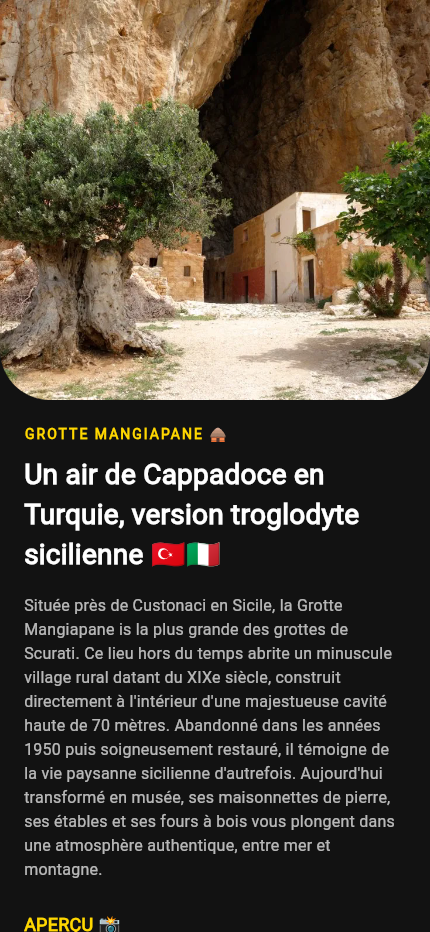</a></td><td align="center"><strong>21 — Scala dei Turchi</strong><br><a href="docs/screenshots/21-scala-dei-turchi.png">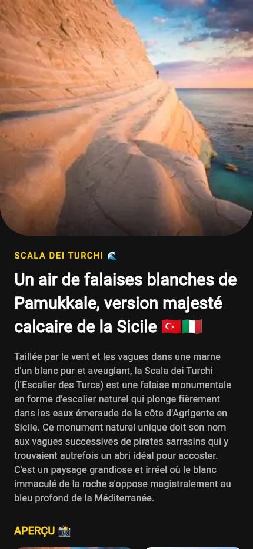</a></td></tr>
<tr><td align="center"><strong>22 — Sicile volcanique</strong><br><a href="docs/screenshots/22-sicile-volcanique.png">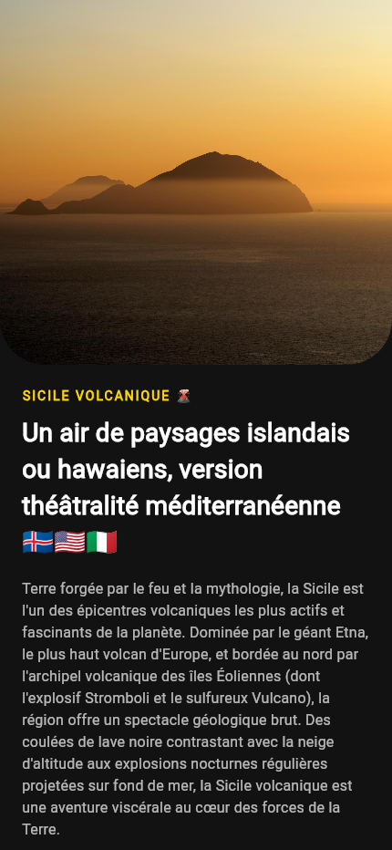</a></td><td></td><td></td></tr>
</table>

<sub>Cliquez sur une image pour consulter la capture originale. Chaque vignette correspond à un écran distinct de l’application.</sub>

## ✦ Fonctionnalités

- Écran d’accueil avec choix du français, de l’anglais ou de l’italien.
- Catalogue de destinations avec classement par région.
- Filtrage et exploration des lieux.
- Fiches détaillées avec textes et photographies.
- Gestion des favoris.
- Cartographie et liens vers les services externes.

## ✦ Technologies

| TECHNOLOGIE | UTILISATION |
|:--|:--|
| **Flutter / Dart** | Application multiplateforme |
| **Google Fonts** | Typographie |
| **Shared Preferences** | Préférences et favoris |
| **URL Launcher** | Ouverture de liens externes |
| **Flutter Map / Latlong2** | Cartographie |
| **GitHub Actions** | Déploiement Web et captures automatisées |
| **Playwright / Chromium** | Captures des écrans Flutter |

## ✦ Mise à jour automatique des captures

Le workflow GitHub Actions s’appuie sur `tool/screenshot_harness.dart` pour afficher les vrais widgets Flutter dans Chromium. Il crée une capture indépendante par écran au format mobile **430 × 932 px**, vérifie que les fichiers attendus existent et contrôle qu’ils ne sont pas identiques avant de les enregistrer dans `docs/screenshots/`.

Le workflow se déclenche sur les mises à jour de la branche `main` ou manuellement dans l’onglet **Actions**. Les captures présentent le rendu Web mobile de l’application Flutter, pas des visuels promotionnels.

## ✦ Installer le projet

Prérequis : Flutter installé et configuré.

```bash
git clone https://github.com/Coco921609/vera_italia.git
cd vera_italia
flutter pub get
flutter run
```

Pour générer la version Web :

```bash
flutter build web --base-href "/vera_italia/"
```

## ✦ Retrouver Vera Italia

- **Application Web :** [Ouvrir Vera Italia](https://coco921609.github.io/vera_italia/)
- **Dépôt GitHub :** [Coco921609/vera_italia](https://github.com/Coco921609/vera_italia)
- **Documentation Flutter :** [docs.flutter.dev](https://docs.flutter.dev/)

---

<p align="center">
  <strong>VERA ITALIA</strong><br>
  <em>Les plus beaux détours sont parfois les moins connus.</em>
</p>


## ✦ Ouvrir ce projet Flutter dans Android Studio

### 1. Cloner le dépôt et entrer dans le dossier

```bash
git clone https://github.com/Coco921609/vera_italia.git
cd vera_italia
```

### 2. Vérifier Flutter et installer les dépendances

Exécutez ces commandes à la racine du projet, dans le dossier qui contient `pubspec.yaml` :

```bash
flutter doctor
flutter pub get
```

### 3. Ouvrir le projet dans Android Studio

**Windows (PowerShell), macOS ou Linux** — si la commande `studio` est disponible dans le PATH :

```bash
studio .
```

Sur macOS, vous pouvez aussi utiliser :

```bash
open -a "Android Studio" .
```

Si `studio` n’est pas reconnu, ouvrez Android Studio manuellement, cliquez sur **Open**, puis sélectionnez le dossier `vera_italia`.

### 4. Démarrer l’application

Démarrez un émulateur Android ou connectez un téléphone avec le débogage USB activé, puis lancez :

```bash
flutter devices
flutter run
```
